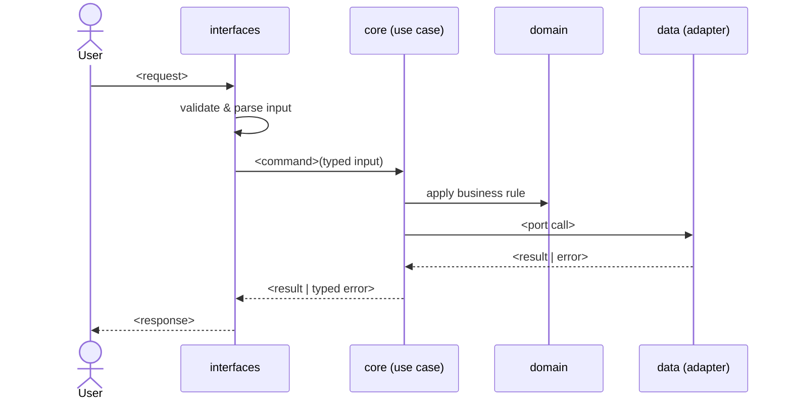

# <PREFIX>-<Module>-NNN: <Title>

<!--
How to use: create new specs with .ai/skills/new-spec, not by hand.
Replace every <placeholder>. Delete guidance comments before requesting approval.
An Approved spec must contain no TBD/TODO (.ai/scripts/validate-specs.sh enforces this).
Project structure and conventions come from .ai/project/; this spec describes behavior and contracts only.
Consumer layers: the contract with the provider layer comes from the specs in "<ProviderLayer> Specs"; this spec consumes it, never redefines it.
-->

## Metadata

| Field | Value |
|---|---|
| ID | <PREFIX>-<Module>-NNN |
| Title | <Short noun phrase> |
| Status | Draft |
| Version | 0.1.0 |
| Author | <name / handle> |
| Owner | <who approves changes> |
| Requirements | <links to the requirement folder(s) in $KB this spec implements, e.g. `[REQ-Billing-001](../../../../Billing/PRD/001-invoice-export/)`, or `none`> |
| Dependencies | <links to the specs of this layer this one builds on, e.g. `[SPEC-001](../../../../_cross-cutting/Implementation/Backend/001-core-system/spec.md)`, or `none`> |
| Dependents | <links to the specs of this layer that depend on this one, or `none`> |
| <ProviderLayer> Specs | <consumer layers only (rename, e.g. `Backend Specs`; delete this row in a provider layer): links to the provider specs whose §3 this spec consumes, e.g. `[SPEC-Billing-001](../../../../Billing/Implementation/Backend/001-invoice-export/spec.md)`, or `none`> |
| Created | YYYY-MM-DD |
| Last Updated | YYYY-MM-DD |

> Status lifecycle: `Draft → Approved → Deprecated`. Only `Approved` specs may be implemented (consumer layers: only against `Approved` provider specs). Only humans change Status.
> Version (semver): MAJOR = breaking §3 contract · MINOR = additive behavior · PATCH = clarification or implementation-only change.

---

## 1. Problem Statement & Motivation

### 1.1 Problem
<!-- Who has the problem, what hurts today, and the evidence (work item #, support ticket, requirement). 3–6 sentences. No solutions here. -->

### 1.2 Goals
<!-- Measurable outcomes. Each one becomes one or more ACs in §5. -->
- G1: <outcome + how we know>

### 1.3 Non-Goals
<!-- What this spec explicitly does NOT do. Prevents scope creep. -->
- NG1: <excluded behavior>

### 1.4 Open Questions
<!-- Must be empty (all resolved) before Status can become Approved. Product-owner answers from the plan's §6 are carried here. -->
| # | Question | Owner | Resolution |
|---|---|---|---|
| Q1 | <question> | <who> | <answer + date, or "open"> |

### 1.5 Assumptions
<!-- Things believed true but not verified. Each assumption is a risk; say what breaks if it's false. -->
- A1: <assumption> — if false: <impact>

---

## 2. Architectural Boundaries & Data Flow

### 2.1 Module Placement
<!-- Replace the generic layers with this repo's real layers and paths (.ai/project/architecture.md). List only what this spec touches. Paths are relative to the repo root. -->
| Layer | Path(s) owned by this spec | Responsibility |
|---|---|---|
| domain | `src/<module>/domain/` | <entities, rules> |
| core | `src/<module>/core/` | <use cases, ports> |
| data | `src/<module>/data/` | <adapters: DB, HTTP clients, other modules> |
| interfaces | `src/<module>/interfaces/` | <entrypoints: endpoints, UI components, jobs> |
| tests | `<tests root or colocated pattern>` | <tests for §5> |

### 2.2 Data Flow


### 2.3 External Dependencies
<!-- Consumer layers: list the provider operations here too, with their failure mode as seen by the user. -->
| Dependency | Purpose | Failure mode | Timeout |
|---|---|---|---|
| <service/lib> | <why> | <what happens when it's down> | <ms> |

### 2.4 Decisions
<!-- Every hard-to-reverse choice not already fixed by .ai/project/. Rule 00 bans unrecorded architectural decisions.
     Respect the approved decision records in $KB/_decisions/ (cite them). A decision that reaches beyond this spec becomes a Draft decision record (rule 01 → Decisions); link it here. -->
<!-- Use the terms of $KB/GLOSSARY.md throughout this spec. -->
| # | Decision | Alternatives considered | Rationale |
|---|---|---|---|
| D1 | <decision> | <options> | <why this one> |

---

## 3. Data Schemas & API Contracts

> Types in this section are **normative**. Implementations match names, types, optionality, and enums exactly.

<!--
Provider layers (APIs, services): 3.1 entities & DTOs, 3.2 operations, 3.3 persistence, 3.4 compatibility & migration.
UI / consumer layers: 3.1 models (field names and optionality as the provider sends them), 3.2 consumed API (each operation linked
to the provider spec §3.2 row it uses, with the provider spec version), 3.3 routes & permissions, 3.4 UI states & form rules
(loading, empty, error, disabled; validation that does not contradict the provider's rules).
-->

### 3.1 Entities & Value Objects
```ts
// Language-neutral typed notation (or the repo's language). `?` = optional; no implicit nulls.
type <EntityId> = string            // format: <uuid v7 | ulid | int | …>

interface <Entity> {
  id: <EntityId>
  <field>: <type>                   // constraints: <min/max/regex/enum>
  createdAt: Timestamp              // UTC, ISO-8601
}
```

### 3.2 Operations / API
| Operation | Route / channel | Input | Output | Errors (§4.2 codes) | Auth | Idempotent |
|---|---|---|---|---|---|---|
| `<verb><Noun>` | `<METHOD> /api/<version>/<resource>` | `<InputType>` | `<OutputType>` | `E_<CODE>` | <role/scope> | yes / no (why) |

<!-- For HTTP, also give status codes and headers. For messages/events: type, producer, consumers, payload schema, ordering and duplicate guarantees. -->

### 3.3 Persistence
<!-- Tables/collections, keys, indexes, uniqueness constraints, retention, migration name. Write "none" if stateless. (UI layers: routes & permissions.) -->

### 3.4 Compatibility & Migration
<!-- Who consumes these contracts (other modules, other layers, mobile/older clients)? What breaks if they change? Migration plan for existing data. (UI layers: UI states & form rules.) -->

---

## 4. Error Modes, Invariants & Edge Cases

### 4.1 Invariants
<!-- Statements that must ALWAYS hold. Each one needs at least one AC. -->
| ID | Invariant |
|---|---|
| INV-01 | <e.g. a <Entity> never has more than N <things>> |

### 4.2 Error Modes
<!-- Consumer layers: each provider error code the screen can receive, and what the user sees. -->
| Code | Trigger | Caller receives | Retryable | Side effects / state after |
|---|---|---|---|---|
| `E_VALIDATION` | input fails §3 constraints | <representation, e.g. 400 + body> | no | none |
| `E_NOT_FOUND` | <…> | <…> | no | none |
| `E_CONFLICT` | <…> | <…> | no | none |
| `E_UPSTREAM_UNAVAILABLE` | <dependency> timeout/5xx | <…> | yes (backoff) | <rolled back?> |

### 4.3 Edge Cases
<!-- Check at least: empty, one, many, max size, duplicate, concurrent writes, partial failure,
     retry after timeout, clock skew and time zones, unicode/locale, missing/expired/wrong-tenant auth,
     deletion while in use, out-of-order or duplicate messages, version skew between clients and server. -->
| ID | Scenario | Expected behavior |
|---|---|---|
| EC-01 | <scenario> | <behavior> |

### 4.4 Security & Privacy
- Authn/Authz: <who can do what>
- Data classification: <PII? retention? encryption at rest/in transit?>
- Abuse cases: <rate limits, enumeration, injection surface>

### 4.5 Non-Functional Requirements
<!-- Only the ones that matter, each with a number: latency p95, throughput, availability, cost, bundle size. -->

---

## 5. Verification Matrix

### Test entry points
<!-- The few public entry points the ACs below are tested through (rule 01 → Module design), reusing existing ones.
     Approving this spec confirms them. Keep the first column E<N> (the validator only reads rows starting with AC-). -->
| # | Entry point | ACs | Notes |
|---|---|---|---|
| E1 | <e.g. `POST /api/v1/invoices`, `InvoiceExportService.export()`, `<InvoiceList>` with a fake API> | AC-01..AC-03 | <what it does not cover, if anything> |

### Acceptance criteria

> Every Goal (§1.2), Invariant (§4.1), Error code (§4.2), and Edge case (§4.3) is covered by at least one AC.
> `Test Reference` = `<path relative to the repo root>::<test name or tag>`; the test carries the tag `<PREFIX>-<Module>-NNN-AC-NN` (how: `$KB/<INDEX>` → *Project paths* → `Test tag`). Required for every AC before Approval.
> Status: `Pending` · `Verified` · `Failing`.

> Each AC is tested at one of the test entry points above. ACs are built one at a time, red → green (rule 00, steps 2–3).

| AC ID | Criterion (Given / When / Then) | Covers | Test Reference | Status |
|---|---|---|---|---|
| AC-01 | **Given** <context> **When** <action> **Then** <observable outcome> | G1 | <tests/...> | Pending |
| AC-02 | **Given** <invalid input> **When** <action> **Then** `E_VALIDATION` and no state change | INV-01, E_VALIDATION | <tests/...> | Pending |
| AC-03 | **Given** <edge context> **When** <action> **Then** <behavior> | EC-01 | <tests/...> | Pending |
